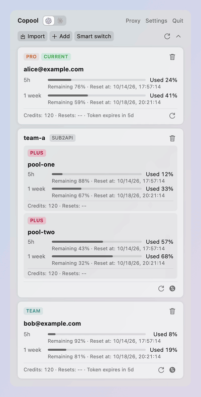
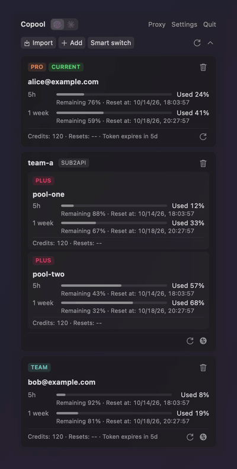

# Copool

<p align="center">
  
</p>

Copool is a cross-platform desktop app (macOS, Windows, Linux) that manages Codex/ChatGPT and Claude Code account pools, usage-based smart switching, and local/remote API proxy workflows. It is built with a Rust core and a Tauri 2 shell.

Copool 是一个跨平台桌面应用（macOS、Windows、Linux），用于管理 Codex/ChatGPT 与 Claude Code 账号池、按用量智能切换，以及本地/远程 API 代理工作流。采用 Rust 核心与 Tauri 2 外壳。

<p align="center">
  
  
</p>

## Features / 功能

- Two account pools, Codex and Claude Code, switched by the colored icons beside the app name (⌘1 / ⌘2)
- Codex 与 Claude Code 两个账号池，由应用名旁的有色图标切换显示（⌘1 / ⌘2）
- Account import/switch/delete and usage refresh (5h / 1week)
- 账号导入/切换/删除与用量刷新（5h / 1week）
- Claude Code accounts: import the Claude Code login or sign in on claude.ai; switching rewrites Claude Code's credentials (the macOS Keychain or `.credentials.json`) and `oauthAccount`, keeping everything else
- Claude Code 账号：导入 Claude Code 当前登录或在 claude.ai 登录添加；切换时改写 Claude Code 的凭据（macOS 钥匙串或 `.credentials.json`）与 `oauthAccount`，其余内容保持不变
- Import and refresh Sub2api upstream accounts: OpenAI/Codex for the Codex pool, and Claude for the Claude pool (switching points Claude Code at the Sub2api gateway through `~/.claude/settings.json`)
- 导入并刷新 Sub2api 上游账号：Codex 池为 OpenAI/Codex 账号，Claude 池为 Claude 账号（切换时经 `~/.claude/settings.json` 让 Claude Code 使用 Sub2api 网关）
- A proxy per account; new accounts wait for a manual refresh before contacting upstream, so their proxy can be set first (configurable)
- 每个账号可设独立代理；新导入的账号默认在手动刷新前不向上游发出请求，以便先设置代理（可在设置中更改）
- Smart switch based on remaining quota score, manual or automatic
- 基于剩余额度评分的智能切换，可手动或自动
- Local OpenAI-compatible API proxy with model compatibility mapping
- 本地 OpenAI 兼容 API 代理与模型兼容映射
- Cloudflared public tunnel management
- Cloudflared 公网隧道管理
- Remote Linux deployment/start/stop/logs for proxy nodes over SSH
- 远程 Linux 代理节点 SSH 部署/启停/日志
- ChatGPT OAuth sign-in, plus editor restart / Codex launch / OpenCode sync on account switch
- ChatGPT OAuth 登录，以及切换账号时的编辑器重启 / 拉起 Codex / 同步 OpenCode
- Status bar panel, and a WidgetKit widget on macOS
- 状态栏面板，macOS 上另有 WidgetKit 小组件

## Requirements / 环境要求

- Rust 1.89+ (current stable recommended)
- macOS 14+ with Xcode (for the WidgetKit extension)
- Windows: Visual Studio C++ Build Tools, Windows SDK, WebView2 Runtime
- Ubuntu 24.04: `build-essential pkg-config libssl-dev libwebkit2gtk-4.1-dev libayatana-appindicator3-dev librsvg2-dev patchelf`

## Build & Run / 构建与运行

```bash
cargo run -p copool-desktop --locked        # run / 运行
python3 scripts/test_rust.py                # tests / 测试
python3 scripts/build_rust_desktop.py       # macOS: ad-hoc-signed Copool.app; elsewhere the executable
```

See [docs/rust-cross-platform.md](docs/rust-cross-platform.md) for details, data locations and validation status.

详细说明、数据目录与验证情况见 [docs/rust-cross-platform.md](docs/rust-cross-platform.md)。

## Project Structure / 项目结构

- `crates/copool-core`: accounts, usage, switching, proxy, tunnel, remote servers and settings; the Claude Code pool in `src/claude.rs` and its Sub2api in `src/claude/sub2api.rs`
- `desktop`: Tauri shell (`src`), web UI (`ui`), UI tests (`tests`), macOS widget (`widget`)
- `resources/proxyd-src`: proxy engine shared by the core and the standalone remote daemon
- `resources/proxyd-prebuilt*`: prebuilt Linux daemons for remote deployment
- `resources/locales`: localized strings (11 languages)
- `scripts`: build, test and localization tooling

## Reference Project / 参考项目

- [170-carry/codex-tools](https://github.com/170-carry/codex-tools)
- [ming86/cc-account-switcher](https://github.com/ming86/cc-account-switcher) and [farion1231/cc-switch](https://github.com/farion1231/cc-switch): how Claude Code accounts and third-party gateways are switched
- [ming86/cc-account-switcher](https://github.com/ming86/cc-account-switcher) 与 [farion1231/cc-switch](https://github.com/farion1231/cc-switch)：Claude Code 账号与第三方网关的切换方式

Copool began as a Swift-native migration and redesign of the original Tauri-based implementation, and has since moved to a cross-platform Rust/Tauri app that keeps the SwiftUI app's interface and behavior.

Copool 最初是对原 Tauri 版本的 Swift 原生迁移与重构，现已迁移为保留 SwiftUI 版界面与交互的跨平台 Rust/Tauri 应用。

## Acknowledgements / 致谢

- Thanks to the original authors and contributors of `170-carry/codex-tools`.
- 感谢 `170-carry/codex-tools` 的原作者与贡献者。
- Thanks to all users who provided migration feedback and UI/UX suggestions.
- 感谢所有提供迁移反馈与界面建议的用户。

## License / 许可证

Copool, including its original Swift implementation, is available under the [MIT License](LICENSE).

Portions inspired by or derived from [`170-carry/codex-tools`](https://github.com/170-carry/codex-tools) remain subject to its MIT License and copyright notice. Third-party dependencies and bundled components remain subject to their respective licenses.

Copool（包括原创 Swift 实现）采用 [MIT 许可证](LICENSE)。

受 [`170-carry/codex-tools`](https://github.com/170-carry/codex-tools) 启发或衍生的部分继续遵循其 MIT 许可证及版权声明。第三方依赖与随附组件仍遵循各自的许可证。
