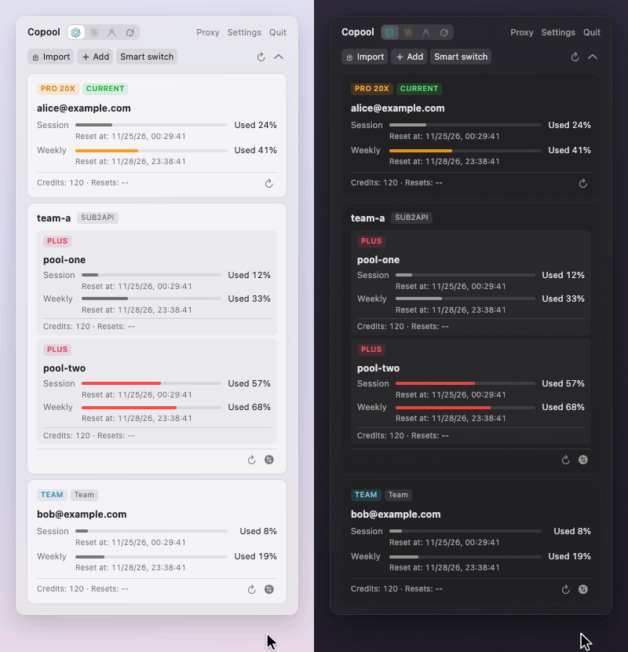

# Copool

<p align="center">
  
</p>

Copool is a cross-platform desktop app (macOS, Windows, Linux) that manages Codex/ChatGPT, Claude Code, Antigravity (Google AI Pro) and Grok (SuperGrok) account pools, usage-based smart switching, and local/remote API proxy workflows. It is built with a Rust core and a Tauri 2 shell.

Copool 是一个跨平台桌面应用（macOS、Windows、Linux），用于管理 Codex/ChatGPT、Claude Code、Antigravity（Google AI Pro）与 Grok（SuperGrok）账号池、按用量智能切换，以及本地/远程 API 代理工作流。采用 Rust 核心与 Tauri 2 外壳。

<p align="center">
  
</p>

## Features / 功能

- Four account pools, Codex, Claude Code, Antigravity and Grok, switched by the icons beside the app name (⌘1 / ⌘2 / ⌘3 / ⌘4)
- Codex、Claude Code、Antigravity 与 Grok 四个账号池，由应用名旁的图标切换显示（⌘1 / ⌘2 / ⌘3 / ⌘4）
- Account import/switch/delete and usage refresh (5h / 1week)
- 账号导入/切换/删除与用量刷新（5h / 1week）
- Claude Code accounts: import the Claude Code login or sign in on claude.ai; switching rewrites Claude Code's credentials (the macOS Keychain or `.credentials.json`) and `oauthAccount`, keeping everything else
- Claude Code 账号：导入 Claude Code 当前登录或在 claude.ai 登录添加；切换时改写 Claude Code 的凭据（macOS 钥匙串或 `.credentials.json`）与 `oauthAccount`，其余内容保持不变
- Antigravity accounts (Google AI Pro): import the Antigravity / `agy` login or a JSON file; cards show the Gemini and Claude 5h / weekly quotas; switching rewrites Antigravity's login (the `gemini` / `antigravity` credential item), and a token renewal of the login it uses is written back there; on macOS the item is read and written only through `/usr/bin/security`, as `agy` does, so its Keychain partition list stays `apple-tool:`
- Antigravity 账号（Google AI Pro）：导入 Antigravity / `agy` 当前登录或 JSON 文件；卡片显示 Gemini 与 Claude 的 5h / 每周额度；切换时改写 Antigravity 的登录（凭据条目 `gemini` / `antigravity`），其当前登录续期后的令牌也写回该条目；macOS 上与 `agy` 一样只经 `/usr/bin/security` 读写该条目，使其钥匙串分区列表保持 `apple-tool:`
- Grok accounts (Grok Build with SuperGrok): import the Grok Build login (`~/.grok/auth.json`, `$GROK_HOME/auth.json`), a JSON file, or sign in at auth.x.ai; cards show the plan and the share of the weekly usage limit used, as `/usage` in Grok Build shows it; switching rewrites Grok Build's sign-in in that file, which it picks up without a restart, and renewed tokens of the sign-in it uses are written back there. The Grok pool has no API proxy or say hi
- Grok 账号（Grok Build / SuperGrok）：导入 Grok Build 当前登录（`~/.grok/auth.json`，或 `$GROK_HOME/auth.json`）、JSON 文件，或在 auth.x.ai 登录添加；卡片显示套餐和每周用量上限的已用比例（与 Grok Build 的 `/usage` 一致）；切换时改写该文件中 Grok Build 的登录，Grok Build 无需重启即生效，其当前登录续期后的令牌也写回该文件。Grok 池没有 API 代理和打招呼
- Import and refresh Sub2api upstream accounts: OpenAI/Codex for the Codex pool, Claude for the Claude pool (switching points Claude Code at the Sub2api gateway through `~/.claude/settings.json`), and Antigravity for the Antigravity pool (switching sets `"modelProvider": "gemini"` in `~/.gemini/antigravity-cli/settings.json`, and in a block of Copool's own at the end of `~/.gemini/.env` sets `GOOGLE_GEMINI_BASE_URL` to the provider's Sub2api URL (through Coport, Coport's with Sub2api's in its path, such as `http://127.0.0.1:8787/antigravity/https://host:6060`, as for Claude's `ANTHROPIC_BASE_URL`; the admin API is still reached at Sub2api) and `GEMINI_API_KEY` to the variable the provider names, `GEMINI_API_KEY` by default, having `~/.zshrc` or `~/.bashrc` load that file if a new shell does not; Copool only names the key's variable, never stores the key; switching to an account removes the block and the `modelProvider`), and Grok for the Grok pool (Sub2api 0.1.155 or later shows each account's weekly usage, from the `seven_day` progress since 0.1.173 and from the billing behind it before; switching points Grok Build’s entire session at the gateway by setting `[endpoints]` `cli_chat_proxy_base_url` and `xai_api_base_url` and `[auth]` `preferred_method = "api_key"` in `~/.grok/config.toml` so model discovery and all models use `/v1/responses` over Sub2api without per-model `base_url` overrides, adding `[model."<id>"] api_backend = "responses"` only for known official Grok text models (learned dynamically from xAI `/models`, `~/.grok/models_cache.json`, or `[models]` roles, with no hardcoded model IDs) omitted by the gateway's `/v1/models`; when the provider names an environment variable other than `XAI_API_KEY`, Copool bridges `XAI_API_KEY` from that variable in a managed block at the end of `~/.grok/.env` and has `~/.zshrc` or `~/.bashrc` load it, never storing the key; switching back to an account restores the replaced endpoints/auth and removes any added model entries and the `.env` block)
- 导入并刷新 Sub2api 上游账号：Codex 池为 OpenAI/Codex 账号，Claude 池为 Claude 账号（切换时经 `~/.claude/settings.json` 让 Claude Code 使用 Sub2api 网关），Antigravity 池为 Antigravity 账号（切换时在 `~/.gemini/antigravity-cli/settings.json` 写入 `"modelProvider": "gemini"`，并在 `~/.gemini/.env` 末尾 Copool 自己的块中把 `GOOGLE_GEMINI_BASE_URL` 设为该提供方的 Sub2api 地址（经 Coport 时填 Coport 地址加 Sub2api 地址，如 `http://127.0.0.1:8787/antigravity/https://host:6060`，与 Claude 的 `ANTHROPIC_BASE_URL` 相同；管理 API 仍直连 Sub2api）、`GEMINI_API_KEY` 设为提供方指定的变量（默认 `GEMINI_API_KEY`）；新 shell 读不到时让 `~/.zshrc` 或 `~/.bashrc` 加载该文件；Copool 只记录 Key 的变量名，不保存 Key；切换回账号时移除该块与 `modelProvider`），Grok 池为 Grok 账号（Sub2api 0.1.155 及以上显示各账号的每周用量：0.1.173 起取 `seven_day`，之前取其背后的 billing；切换时在 `~/.grok/config.toml` 统一设置会话级 `[endpoints]` 的 `cli_chat_proxy_base_url`、`xai_api_base_url` 与 `[auth]` 的 `preferred_method = "api_key"`，让模型目录与整个会话所有模型都经 Sub2api 走 `/v1/responses`，不再写逐模型 `base_url`；仅对网关 `/v1/models` 尚未列出的官方 Grok 文本模型（动态取自 xAI `/models`、`~/.grok/models_cache.json` 或 `[models]` 角色，不硬编码模型名）补写 `[model."<id>"] api_backend = "responses"`；提供方指定非 `XAI_API_KEY` 的环境变量名时，在 `~/.grok/.env` 末尾写入 Copool 专属块将其桥接到 `XAI_API_KEY` 并由 `~/.zshrc` 或 `~/.bashrc` 加载，不保存 Key 本身；切回账号时恢复原端点与认证配置并移除补写的模型段与 `.env` 块）
- CLIProxyAPI providers in every pool, beside Sub2api: one CLIProxyAPI server lists every pool's credentials, so its provider is added once, choosing no pool, and is every pool's (its name, management site, key, proxy and TLS check kept once; its API address (blank: the management site's root) and the variable holding its API key (`CLIPROXYAPI_API_KEY` unless named) are given once for every pool; each pool imports its own cards; Codex switches to the `config.toml` provider of its name); several can be added, but not two with the same management site and key; Copool reaches CLIProxyAPI's management API (v8) with its management key, lists the pool's credentials (Codex, Claude, Antigravity, xAI for Grok) as cards, reads each one's usage by having CLIProxyAPI relay the pool's own usage request with that credential's token (`/requests/api-call`), and says hi through CLIProxyAPI's inference check of the credential (`/credentials/verify`; Codex Plus and Claude cards), or for an Antigravity card as the pool's own accounts do, through that relay; switching points the pool's tool at the provider's gateway as for Sub2api (agy's `GOOGLE_GEMINI_BASE_URL` is CLIProxyAPI's root)
- 除 Sub2api 外，每个池也可添加 CLIProxyAPI 提供方，且同一个 CLIProxyAPI 列出所有池的凭据，添加时不选池，添加一次即对所有池生效（名称、管理站点、密钥、代理与 TLS 设置只存一份，各池的切换设置与导入的卡片各自独立，Codex 切换到 `config.toml` 中同名的 provider）；可添加多个，但管理站点与密钥都相同的会被拒绝：Copool 用管理密钥访问其管理 API（v8），把该池的凭据（Codex、Claude、Antigravity，Grok 为 xAI）列为卡片；用量由 CLIProxyAPI 以该凭据的令牌代发与官方账号相同的请求（`/requests/api-call`）读取，打招呼用 CLIProxyAPI 对该凭据的推理检查（`/credentials/verify`，限 Codex Plus 与 Claude 卡片），Antigravity 卡片则经同一中转与官方账号一样打招呼；切换时与 Sub2api 一样让工具使用提供方网关（agy 的 `GOOGLE_GEMINI_BASE_URL` 为 CLIProxyAPI 根地址）
- A proxy per account; new accounts wait for a manual refresh before contacting upstream, so their proxy can be set first (configurable)
- 每个账号可设独立代理；新导入的账号默认在手动刷新前不向上游发出请求，以便先设置代理（可在设置中更改）
- Smart switch based on remaining quota score, manual or automatic
- 基于剩余额度评分的智能切换，可手动或自动
- Local OpenAI-compatible API proxy with model compatibility mapping
- 本地 OpenAI 兼容 API 代理与模型兼容映射
- The Antigravity proxy serves `antigravity-cli` (`agy`). Start it on the API Proxy page, copy its base URL and key into `GOOGLE_GEMINI_BASE_URL` and `GEMINI_API_KEY` for the CLI process, then run `agy --settings '{"modelProvider":"gemini"}'`.
- 在 API 代理页选择 Antigravity 并启动，将页面上的地址和密钥分别作为 `GOOGLE_GEMINI_BASE_URL` 和 `GEMINI_API_KEY` 传给 CLI，再运行 `agy --settings '{"modelProvider":"gemini"}'`。默认地址为 `http://127.0.0.1:8789/antigravity`。
- Cloudflared public tunnel management
- Cloudflared 公网隧道管理
- Remote Linux deployment/start/stop/logs for proxy nodes over SSH. Antigravity nodes serve `agy` at `http://<host>:<port>/antigravity` using the node’s own API key.
- 远程 Linux 代理节点 SSH 部署/启停/日志。Antigravity 的 Remote Servers 支持部署和同步订阅账号；将节点的 `http://<主机>:<端口>/antigravity` 地址和节点密钥传给 `agy`。
- ChatGPT OAuth sign-in, plus editor restart / Codex launch / OpenCode sync on account switch
- ChatGPT OAuth 登录，以及切换账号时的编辑器重启 / 拉起 Codex / 同步 OpenCode
- Status bar panel, and a WidgetKit widget on macOS
- 状态栏面板，macOS 上另有 WidgetKit 小组件

## Requirements / 环境要求

- Rust 1.89+ (current stable recommended)
- macOS 14+ with Xcode (for the WidgetKit extension)
- Windows: Visual Studio C++ Build Tools, Windows SDK, WebView2 Runtime
- Ubuntu 24.04: `build-essential pkg-config libssl-dev libwebkit2gtk-4.1-dev libayatana-appindicator3-dev librsvg2-dev patchelf`

## Build & Run / 构建与运行

```bash
cargo run -p copool-desktop --locked        # run / 运行
python3 scripts/test_rust.py                # tests / 测试
python3 scripts/build_rust_desktop.py       # macOS: locally signed Copool.app; Windows: NSIS installer; Linux: the executable
python3 scripts/restart_copool.py --app …    # restart the copy at that path / 重启该位置的 Copool
```

See [docs/rust-cross-platform.md](docs/rust-cross-platform.md) for details, data locations and validation status.

详细说明、数据目录与验证情况见 [docs/rust-cross-platform.md](docs/rust-cross-platform.md)。

## Project Structure / 项目结构

- `crates/copool-core`: accounts, usage, switching, proxy, tunnel, remote servers and settings; the Claude Code pool in `src/claude.rs` and its Sub2api in `src/claude/sub2api.rs`; the Antigravity pool in `src/antigravity.rs` and its Sub2api in `src/antigravity/sub2api.rs`; the Grok pool in `src/grok.rs` and its Sub2api in `src/grok/sub2api.rs`; what every unofficial provider (Sub2api, CLIProxyAPI) does with its cards in `src/provider_accounts.rs` and `src/provider_registry.rs`, CLIProxyAPI's management API in `src/cliproxyapi.rs` and each pool's relayed usage in `src/<pool>/cliproxyapi.rs`
- `desktop`: Tauri shell (`src`), web UI (`ui`), UI tests (`tests`), macOS widget (`widget`)
- `resources/proxyd-src`: proxy engine shared by the core and the standalone remote daemon
- `resources/proxyd-prebuilt*`: prebuilt Linux daemons for remote deployment
- `resources/locales`: localized strings (11 languages)
- `scripts`: build, test and localization tooling

## Reference Project / 参考项目

- [170-carry/codex-tools](https://github.com/170-carry/codex-tools)
- OpenQuota: how Antigravity's login and quota are read
- OpenQuota：Antigravity 登录与额度的读取方式
- [ming86/cc-account-switcher](https://github.com/ming86/cc-account-switcher) and [farion1231/cc-switch](https://github.com/farion1231/cc-switch): how Claude Code accounts and third-party gateways are switched
- [ming86/cc-account-switcher](https://github.com/ming86/cc-account-switcher) 与 [farion1231/cc-switch](https://github.com/farion1231/cc-switch)：Claude Code 账号与第三方网关的切换方式

Copool began as a Swift-native migration and redesign of the original Tauri-based implementation, and has since moved to a cross-platform Rust/Tauri app that keeps the SwiftUI app's interface and behavior.

Copool 最初是对原 Tauri 版本的 Swift 原生迁移与重构，现已迁移为保留 SwiftUI 版界面与交互的跨平台 Rust/Tauri 应用。

## Acknowledgements / 致谢

- Thanks to the original authors and contributors of `170-carry/codex-tools`.
- 感谢 `170-carry/codex-tools` 的原作者与贡献者。
- Thanks to all users who provided migration feedback and UI/UX suggestions.
- 感谢所有提供迁移反馈与界面建议的用户。

## License / 许可证

Copool, including its original Swift implementation, is available under the [MIT License](LICENSE).

Portions inspired by or derived from [`170-carry/codex-tools`](https://github.com/170-carry/codex-tools) remain subject to its MIT License and copyright notice. Third-party dependencies and bundled components remain subject to their respective licenses.

Copool（包括原创 Swift 实现）采用 [MIT 许可证](LICENSE)。

受 [`170-carry/codex-tools`](https://github.com/170-carry/codex-tools) 启发或衍生的部分继续遵循其 MIT 许可证及版权声明。第三方依赖与随附组件仍遵循各自的许可证。
